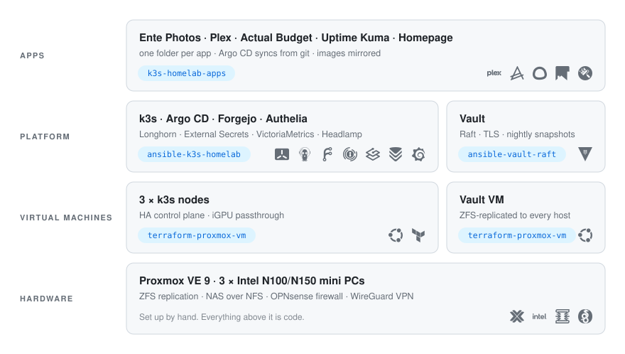
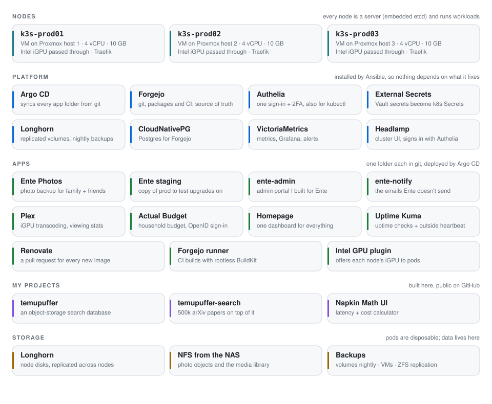
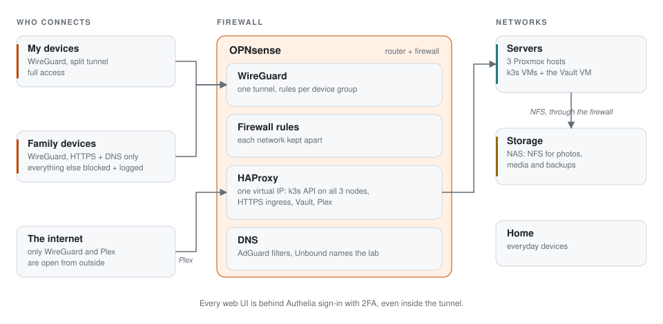
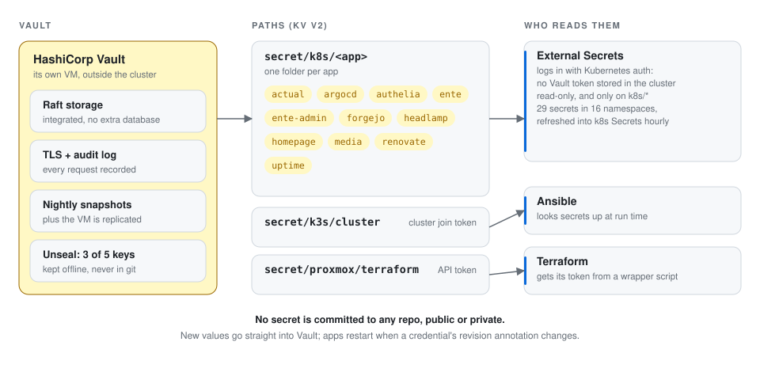
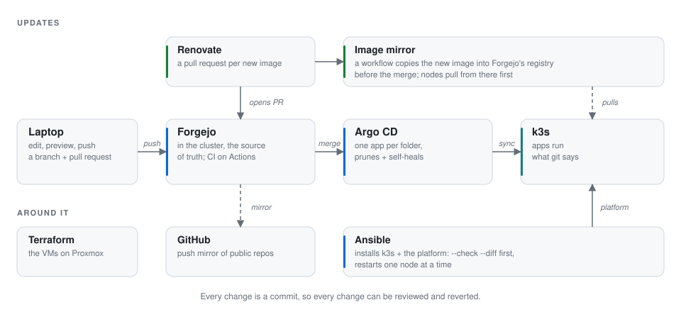

# homelab

A three-node Kubernetes cluster on mini PCs, built and run entirely from code.

<picture>
  <source media="(prefers-color-scheme: dark)" srcset="docs/stack-dark.svg">
  
</picture>

**3** Proxmox hosts · **3** k3s nodes · **~30** namespaces · **~140** pods · **29** secrets from Vault ·
**24** network policies · **1** sign-in for all of it

## What's inside

Everything that runs here, including the parts whose config lives in private repos. The
diagrams are generated by [`docs/diagrams.py`](docs/diagrams.py).

### The cluster

Three VMs, one per Proxmox host, each a k3s server and a worker. The platform layer is
installed by Ansible; every app above it is a folder in git that Argo CD keeps in sync.

<picture>
  <source media="(prefers-color-scheme: dark)" srcset="docs/cluster-dark.svg">
  
</picture>

### Network and firewall

Nothing is open to the internet except the WireGuard endpoint and Plex. Devices come in over
WireGuard, and OPNsense decides per group what they can reach: my devices get everything,
family devices get HTTPS and DNS only. HAProxy on OPNsense puts one address in front of all
three nodes, so a node can go down without anything noticing.

<picture>
  <source media="(prefers-color-scheme: dark)" srcset="docs/network-dark.svg">
  
</picture>

### Secrets

Vault runs on its own VM, outside the cluster: the cluster can be rebuilt without losing a
secret, and a broken cluster can't lock me out of Vault. Apps get their secrets through
External Secrets; Ansible and Terraform look them up when they run.

<picture>
  <source media="(prefers-color-scheme: dark)" srcset="docs/secrets-dark.svg">
  
</picture>

### Getting a change in

<picture>
  <source media="(prefers-color-scheme: dark)" srcset="docs/gitops-dark.svg">
  
</picture>

### The apps

| | What it is | Notes |
|---|---|---|
| **Ente Photos** | End-to-end encrypted photo backup for family and friends | A staging copy for testing upgrades. Photos sit on the NAS behind an S3 server in the cluster. The server is built from upstream with one small patch |
| **[ente-admin](https://github.com/mipapi1/ente-admin)** | An admin dashboard for self-hosted Ente | My project. Runs in prod and staging, behind Authelia |
| **ente-notify** | The emails Ente doesn't send | Album shares, new photos in shared albums, and a (funny) reminder when someone stops backing up |
| **Plex** | Movies and shows | Transcodes on the node's Intel iGPU; the library is on the NAS |
| **Actual Budget** | The household budget | Own image, OpenID sign-in through Authelia |
| **Homepage** | One page with every service and its status | Read-only access to the cluster and Proxmox |
| **Uptime Kuma** | Is everything up? | Checks are declared in git; alerts go through Alertmanager, and an outside heartbeat catches the cluster going silent |
| **Grafana** | Metrics for the cluster, the nodes and Proxmox | VictoriaMetrics behind it, 30 days kept; alerts to phone and email |
| **Headlamp** | A web UI for the cluster | Signs in with Authelia (OIDC), the same way `kubectl` does |
| **Forgejo** | Git, container registry and CI | CI builds images in the cluster with rootless BuildKit |
| **Renovate** | Keeps every image current | One pull request per new version |
| **[temupuffer](https://github.com/mipapi1/temupuffer)** | A search database on object storage, a search app on top, and a napkin-math calculator | My project, in its own namespaces |

## Repositories

| | |
|---|---|
| [**terraform-proxmox-vm**](https://github.com/mipapi1/terraform-proxmox-vm) | Terraform module: VMs cloned from a cloud-init template, with optional GPU passthrough |
| [**ansible-k3s-homelab**](https://github.com/mipapi1/ansible-k3s-homelab) | Ansible collection: the platform on k3s: GitOps, SSO with 2FA, secrets, storage, monitoring |
| [**k3s-homelab-apps**](https://github.com/mipapi1/k3s-homelab-apps) | The apps, as Kustomize folders Argo CD deploys |
| [**ansible-vault-raft**](https://github.com/mipapi1/ansible-vault-raft) | Ansible role: HashiCorp Vault on its own VM, with integrated storage |
| [**ente-admin**](https://github.com/mipapi1/ente-admin) | Admin dashboard for self-hosted Ente |

Public code, private config. Each public repo is generic and tested in CI; the inventories,
addresses and settings that make it _this_ homelab live in private repos (cluster config, VM
definitions, the Vault deployment, the Ente server build) that pin these by version.

## How it works

- **Git is the only way in.** A push to Forgejo (self-hosted, in the cluster) is picked up
  by Argo CD. GitHub gets a mirror.
- **Secrets never touch git.** They live in Vault, outside the cluster.
- **Updates are pull requests.** Renovate opens one per new image version; a workflow
  copies the image into the local registry before the merge, and nodes pull from there
  first.
- **One sign-in.** Authelia with 2FA guards every UI and `kubectl` itself (OpenID Connect).
- **Locked down inside too.** Network policies decide which pods may talk to which.
- **Hardware transcoding.** Each node's Intel iGPU is passed through to its VM and offered
  to Kubernetes; Plex asks for one.
- **Backups at every layer.** Volumes nightly to the NAS, Vault snapshots, whole-VM
  backups, ZFS replication between hosts.
- **Alerts that reach a phone.** Alertmanager pushes to ntfy and email, and an outside
  heartbeat notices if the cluster goes quiet.

## Rules it follows

- **Preview every change.** `terraform plan` and `ansible-playbook --check --diff` first;
  refactors are done when they show no changes.
- **Nothing depends on what it fixes.** Argo CD, the git server, sign-in and the admin UI
  are installed by Ansible, not by Argo CD. Vault runs outside the cluster.
- **Restarts are rolling and deliberate.** k3s config changes restart one node at a time,
  checking etcd in between. Vault is never restarted by automation, since that seals it.

## Hardware

Three Intel N100/N150 mini PCs running a Proxmox VE 9 cluster, a NAS for photos, media and
backups, and OPNsense as the firewall.
