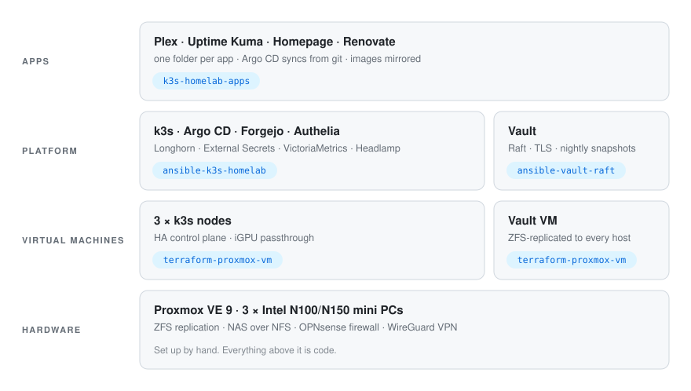

# homelab

A three-node Kubernetes cluster on mini PCs, built and run entirely from code.

<picture>
  <source media="(prefers-color-scheme: dark)" srcset="docs/stack-dark.svg">
  
</picture>

## Repositories

| | |
|---|---|
| [**terraform-proxmox-vm**](https://github.com/mipapi1/terraform-proxmox-vm) | Terraform module: VMs cloned from a cloud-init template, with optional GPU passthrough |
| [**ansible-k3s-homelab**](https://github.com/mipapi1/ansible-k3s-homelab) | Ansible collection: the platform on k3s: GitOps, SSO with 2FA, secrets, storage, monitoring |
| [**k3s-homelab-apps**](https://github.com/mipapi1/k3s-homelab-apps) | The apps, as Kustomize folders Argo CD deploys |
| [**ansible-vault-raft**](https://github.com/mipapi1/ansible-vault-raft) | Ansible role: HashiCorp Vault on its own VM, with integrated storage |

Public code, private config. Each repo here is generic and tested in CI; the inventories,
addresses and secrets that make it _this_ homelab live in private repos that pin these
by version.

## How it works

- **Git is the only way in.** A push to Forgejo (self-hosted, in the cluster) is picked up
  by Argo CD. GitHub gets a mirror.
- **Secrets never touch git.** They live in Vault, outside the cluster; External Secrets
  hands them to apps, Ansible looks them up at run time.
- **Updates are pull requests.** Renovate opens one per new image version; a workflow
  copies the image into the local registry before the merge, and nodes pull from there
  first.
- **One sign-in.** Authelia with 2FA guards every UI and `kubectl` itself (OpenID Connect).
- **Hardware transcoding.** Each node's Intel iGPU is passed through to its VM and offered
  to Kubernetes; Plex asks for one.
- **Backups at every layer.** Volumes nightly to the NAS, Vault snapshots, whole-VM
  backups, ZFS replication between hosts.
- **Alerts that reach a phone.** VictoriaMetrics and Uptime Kuma push to ntfy and email,
  and an outside heartbeat notices if the cluster goes quiet.

## Rules it follows

- **Preview every change.** `terraform plan` and `ansible-playbook --check --diff` first;
  refactors are done when they show no changes.
- **Nothing depends on what it fixes.** Argo CD, the git server, sign-in and the admin UI
  are installed by Ansible, not by Argo CD. Vault runs outside the cluster.
- **Restarts are rolling and deliberate.** k3s config changes restart one node at a time,
  checking etcd in between. Vault is never restarted by automation, since that seals it.

## Hardware

Three Intel N100/N150 mini PCs running a Proxmox VE 9 cluster, a NAS for media and
backups, and OPNsense as the firewall.
